# cc-translate

[](https://github.com/jzx05/cc-translate/actions/workflows/test.yml)
[](https://github.com/jzx05/cc-translate/releases)
[](LICENSE)

[English](README.md) · [简体中文](README.zh-CN.md) · **한국어**

**모국어로 [Claude Code](https://code.claude.com)를 사용하세요. Claude는 영어만 보게 됩니다.**

cc-translate는 Claude Code 플러그인입니다. 한국어, 중국어, 일본어 또는 러시아어로 입력하면 프롬프트가 Claude에 전달되기 전에 영어로 번역됩니다. Claude의 영어 답변은 화면에 사용자의 언어로 표시됩니다.

<p align="center"></p>
<p align="center"><sub>동작 흐름 예시</sub></p>

- **Claude의 컨텍스트는 항상 영어입니다.** 프롬프트는 세션에 들어가기 전에 교체되므로 대화 기록, 대화 메모리, 입력 기록에는 모두 영어가 저장됩니다. 답변 번역은 화면 표시만 바꿉니다.
- **번역되지 않은 내용은 전송되지 않습니다.** 한 번 더 엄격하게 재시도한 뒤에도 번역문에 영어가 아닌 문자가 남아 있거나 번역 요청이 실패하면, 프롬프트는 전송되지 않고 이유와 함께 입력창으로 돌아갑니다.
- **코드는 한 바이트도 바뀌지 않습니다.** 답변 속 코드 블록은 번역 모델로 보내지 않고 그대로 되돌려 놓습니다. 인라인 코드, 경로, 식별자, URL은 모델이 그대로 유지합니다.
- **OpenAI 호환 번역 서비스라면 무엇이든 사용할 수 있습니다.** 기본값은 DeepSeek `deepseek-flash`이며(프롬프트 번역 1초 미만), OpenAI, Qwen 등 `/chat/completions`를 지원하는 서비스로 바꿀 수 있습니다.

## 설치

Claude Code 프롬프트에서:

```
/plugin install cc-translate --marketplace jzx05/cc-translate
```

`y`를 눌러 마켓플레이스를 추가한 뒤 설치 범위를 선택하세요(user를 고르면 모든 프로젝트에서 동작합니다). 셸에서 설치할 수도 있습니다:

```bash
claude plugin install cc-translate --marketplace jzx05/cc-translate
```

Claude Code 2.1.287 이상이 필요합니다(플러그인이 hooks 모듈 API를 사용합니다).

## 설정

번역 서비스의 API 키를 플러그인 옵션이나 환경 변수로 설정하세요:

```
/plugin configure cc-translate@cc-translate
```

```bash
export CC_TRANSLATE_API_KEY="sk-..."   # api_key 옵션이 비어 있을 때 사용
```

그다음 `/translate config`로 현재 적용 중인 설정을 확인하세요. 한국어로 쓰려면 `lang`을 `Korean`으로 설정합니다.

| 옵션 | 기본값 | 설명 |
|---|---|---|
| `lang` | `Simplified Chinese` | 사용자의 언어: `Korean`(한국어), `Simplified Chinese`, `Traditional Chinese`, `Japanese`, `Russian`. 답변과 플러그인 자체 메시지에 사용됩니다. |
| `base_url` | `https://api.deepseek.com` | OpenAI 호환 엔드포인트. `/chat/completions` 앞부분을 입력합니다. |
| `model` | `deepseek-flash` | 작고 빠른 모델이면 충분합니다. |
| `api_key` | (비어 있음) | 시스템 보안 저장소에 보관됩니다. 비어 있으면 `CC_TRANSLATE_API_KEY`를 사용합니다. |
| `extra_body` | `{"thinking":{"type":"disabled"}}` | 모든 요청에 병합되는 JSON. 기본값은 DeepSeek의 thinking을 끕니다. 알 수 없는 필드를 거부하는 서비스에서는 `{}`로 설정하세요. |
| `enabled` | `true` | 기본 켜짐/꺼짐 상태. `/translate on`과 `/translate off`가 이를 덮어쓰며 기억됩니다. |

### 다른 서비스

| 서비스 | `base_url` | `extra_body` |
|---|---|---|
| DeepSeek | `https://api.deepseek.com` | `{"thinking":{"type":"disabled"}}` |
| OpenAI | `https://api.openai.com/v1` | `{}` |

`model`에는 해당 서비스가 제공하는 모델 이름을 입력하세요.

### 용어집

특정 용어의 번역을 고정하려면 `~/.config/cc-translate/glossary.json`을 만드세요:

```json
{ "연산자": "operator", "텐서": "tensor" }
```

입력과 출력 양방향에 사용됩니다. 수정한 뒤 `/translate reload`를 실행하세요.

## 명령어

| 명령어 | 기능 |
|---|---|
| `/translate on` / `off` | 번역을 켜거나 끕니다(세션이 바뀌어도 기억). 상태 표시줄에 현재 상태가 표시됩니다. |
| `/translate retry` | 실패한 답변을 다시 번역합니다. |
| `/translate reload` | 용어집을 다시 불러오고 다시 번역합니다. |
| `/translate config` | 현재 적용 중인 설정을 보여 줍니다. API 키 자체는 표시하지 않습니다. |
| `/translate` | 한 줄 상태 요약. |

## 동작 방식

| 방향 | Hook | 동작 |
|---|---|---|
| 입력 | `prompt.submit` | 사용자가 입력한 프롬프트에 라틴 문자가 아닌 글자가 있으면 영어로 번역하고, 검사한 뒤 원문을 교체합니다. `/명령어`와 `!셸` 줄은 건드리지 않습니다. |
| 출력 | `AssistantMessage`의 `ui.render` | 답변 블록이 약 1.2초 동안 바뀌지 않으면 코드 블록을 뺀 채 한 번에 번역해 사용자의 언어로 표시합니다. 약 6000자를 넘는 답변은 문단 단위로 나눕니다. 번역에 실패한 부분은 영어로 남고, 이유를 알리는 알림이 뜹니다. |

## 개발

```bash
git clone https://github.com/jzx05/cc-translate
claude --plugin-dir ./cc-translate     # 폴더에서 바로 실행
claude plugin test ./cc-translate      # 테스트 실행
claude plugin validate ./cc-translate
```

- `hooks/register.ts`: hook 등록.
- `hooks/translator.ts`: 번역 서비스 호출.
- `hooks/text.ts`: 순수 텍스트 로직.
- `hooks/i18n.ts`: 플러그인 자체 메시지.

## 라이선스

[MIT](LICENSE)
