# cc-translate

[](https://github.com/jzx05/cc-translate/actions/workflows/test.yml)
[](https://github.com/jzx05/cc-translate/releases)
[](LICENSE)

**English** · [简体中文](README.zh-CN.md)

**Work with [Claude Code](https://code.claude.com) in your own language, while Claude only ever sees English.**

cc-translate is a Claude Code plugin. You type in Chinese, Japanese, Korean or Russian. Your prompt is translated to English before it reaches Claude. Claude's English replies are shown on your screen in your language.

<p align="center"></p>
<p align="center"><sub>Illustration of the flow</sub></p>

- **Claude's context stays in English.** The prompt is replaced before it enters the session, so the transcript, the conversation memory and the prompt history all hold English. Reply translation changes the display only.
- **Nothing untranslated is sent.** A prompt whose translation still contains non-English text after one strict retry, or whose translation request fails, is not sent. It goes back to your input box with the reason.
- **Code stays exact.** Fenced code blocks in replies never go to the translator and come back byte for byte. Inline code, paths, identifiers and URLs are kept as written by the model.
- **Any OpenAI-compatible translator.** The default is DeepSeek `deepseek-flash` (prompts take under a second). OpenAI, Qwen or any other hosted service that speaks `/chat/completions` works too.

## Install

At the Claude Code prompt:

```
/plugin install cc-translate --marketplace jzx05/cc-translate
```

Answer `y` to add the marketplace, then pick a scope (user scope makes it work in every project). From a shell:

```bash
claude plugin install cc-translate --marketplace jzx05/cc-translate
```

Requires Claude Code 2.1.287 or later (the plugin uses the hooks-module API).

## Configure

Set the translator's API key, either in the plugin's options or in your shell:

```
/plugin configure cc-translate@cc-translate
```

```bash
export CC_TRANSLATE_API_KEY="sk-..."   # used when the api_key option is empty
```

Then run `/translate config` to see the settings in force.

| Option | Default | Notes |
|---|---|---|
| `lang` | `Simplified Chinese` | Your language: `Simplified Chinese`, `Traditional Chinese`, `Japanese`, `Korean` or `Russian`. Replies and the plugin's own messages use it. |
| `base_url` | `https://api.deepseek.com` | Any OpenAI-compatible endpoint: the part before `/chat/completions`. |
| `model` | `deepseek-flash` | A small, fast model is enough. |
| `api_key` | (empty) | Kept in secure storage. When empty, `CC_TRANSLATE_API_KEY` is used. |
| `extra_body` | `{"thinking":{"type":"disabled"}}` | JSON merged into every request. The default turns DeepSeek's thinking off. Set `{}` for providers that refuse unknown fields. |
| `enabled` | `true` | Default state. `/translate on` and `/translate off` override it and are remembered. |

### Other providers

| Provider | `base_url` | `extra_body` |
|---|---|---|
| DeepSeek | `https://api.deepseek.com` | `{"thinking":{"type":"disabled"}}` |
| OpenAI | `https://api.openai.com/v1` | `{}` |

Set `model` to a model that the endpoint serves.

### Glossary

To pin how terms are translated, create `~/.config/cc-translate/glossary.json`:

```json
{ "算子": "operator", "张量": "tensor" }
```

It is used in both directions. Run `/translate reload` after editing it.

## Commands

| Command | What it does |
|---|---|
| `/translate on` / `off` | Turn translation on or off (remembered across sessions). The status line shows the state. |
| `/translate retry` | Translate again the replies that failed. |
| `/translate reload` | Reload the glossary and re-translate. |
| `/translate config` | Show the settings in force. The API key is never shown. |
| `/translate` | One-line status. |

## How it works

| Direction | Hook | Behavior |
|---|---|---|
| Input | `prompt.submit` | A prompt with non-Latin letters, typed by you, is translated to English, checked, and replaces your text. `/commands` and `!shell` lines are left alone. |
| Output | `ui.render` on `AssistantMessage` | About 1.2 s after a reply block stops changing, it is translated in one request with its code blocks taken out, then drawn in your language. Replies over about 6000 characters are cut at paragraph breaks. A part that fails stays in English, and a toast says why. |

## Development

```bash
git clone https://github.com/jzx05/cc-translate
claude --plugin-dir ./cc-translate     # run it from the folder
claude plugin test ./cc-translate      # run the tests
claude plugin validate ./cc-translate
```

- `hooks/register.ts` wires the hooks.
- `hooks/translator.ts` calls the translator.
- `hooks/text.ts` holds the pure text logic.
- `hooks/i18n.ts` holds the plugin's messages.

## License

[MIT](LICENSE)
