# cc-translate

[](https://github.com/jzx05/cc-translate/actions/workflows/test.yml)
[](https://github.com/jzx05/cc-translate/releases)
[](LICENSE)

[English](README.md) · **简体中文** · [한국어](README.ko.md)

**用母语使用 [Claude Code](https://code.claude.com)，Claude 只会看到英文。**

cc-translate 是一个 Claude Code 插件。你用中文、日语、韩语或俄语输入，prompt 会在发给 Claude 之前翻译成英文；Claude 的英文回复会以你的语言显示在屏幕上。

<p align="center"></p>
<p align="center"><sub>流程示意</sub></p>

- **Claude 的上下文全程英文。** prompt 在进入会话前就被替换，对话记录、会话记忆、输入历史里存的都是英文。回复的翻译只改屏幕显示。
- **没翻译干净的内容不会发出去。** 译文严格重试一次后仍有非英文字符，或者翻译请求失败，prompt 就不发送，退回输入框并说明原因。
- **代码一个字节都不变。** 回复里的代码块不会发给翻译模型，原样放回。行内代码、路径、标识符、URL 由模型保持原样。
- **支持任何 OpenAI 兼容的翻译服务。** 默认 DeepSeek `deepseek-flash`（prompt 翻译不到 1 秒），也可以换成 OpenAI、通义千问等任何支持 `/chat/completions` 的服务。

## 安装

在 Claude Code 里输入：

```
/plugin install cc-translate --marketplace jzx05/cc-translate
```

按 `y` 添加 marketplace，再选择安装范围（选 user 就在所有项目里生效）。也可以在终端里安装：

```bash
claude plugin install cc-translate --marketplace jzx05/cc-translate
```

需要 Claude Code 2.1.287 或更高版本（插件用到了 hooks 模块 API）。

## 配置

填上翻译服务的 API key，在插件选项里填或者用环境变量都可以：

```
/plugin configure cc-translate@cc-translate
```

```bash
export CC_TRANSLATE_API_KEY="sk-..."   # api_key 选项为空时使用
```

然后运行 `/translate config` 查看当前生效的配置。

| 选项 | 默认值 | 说明 |
|---|---|---|
| `lang` | `Simplified Chinese` | 你的语言：`Simplified Chinese`（简体中文）、`Traditional Chinese`（繁体中文）、`Japanese`（日语）、`Korean`（韩语）、`Russian`（俄语）。回复和插件自己的提示都用这种语言。 |
| `base_url` | `https://api.deepseek.com` | 任何 OpenAI 兼容接口，填 `/chat/completions` 前面的部分。 |
| `model` | `deepseek-flash` | 小而快的模型就够用。 |
| `api_key` | （空） | 存在系统安全存储里。为空时读取 `CC_TRANSLATE_API_KEY`。 |
| `extra_body` | `{"thinking":{"type":"disabled"}}` | 合并进每次请求的 JSON。默认值用来关闭 DeepSeek 的 thinking。换成不接受未知字段的服务商时设为 `{}`。 |
| `enabled` | `true` | 默认开关状态。`/translate on` 和 `/translate off` 会覆盖它，并且会被记住。 |

### 其他服务商

| 服务商 | `base_url` | `extra_body` |
|---|---|---|
| DeepSeek | `https://api.deepseek.com` | `{"thinking":{"type":"disabled"}}` |
| OpenAI | `https://api.openai.com/v1` | `{}` |

`model` 填该服务提供的模型名。

### 术语表

想固定某些术语的译法，可以创建 `~/.config/cc-translate/glossary.json`：

```json
{ "算子": "operator", "张量": "tensor" }
```

输入和输出两个方向都会用到。改完后运行 `/translate reload`。

## 命令

| 命令 | 作用 |
|---|---|
| `/translate on` / `off` | 打开或关闭翻译（跨会话记住），状态栏会显示当前状态。 |
| `/translate retry` | 重新翻译之前失败的回复。 |
| `/translate reload` | 重新加载术语表并重新翻译。 |
| `/translate config` | 显示当前生效的配置，不会显示 API key 本身。 |
| `/translate` | 一行状态摘要。 |

## 工作原理

| 方向 | Hook | 行为 |
|---|---|---|
| 输入 | `prompt.submit` | 你输入的 prompt 如果含非拉丁字母，会被翻译成英文、检查后替换原文。`/命令` 和 `!shell` 行不处理。 |
| 输出 | `ui.render` 的 `AssistantMessage` | 回复块停止变化约 1.2 秒后，去掉代码块整块翻译一次，再以你的语言显示。超过约 6000 字符的回复按段落切开。翻译失败的部分保留英文，并弹出提示说明原因。 |

## 开发

```bash
git clone https://github.com/jzx05/cc-translate
claude --plugin-dir ./cc-translate     # 直接从文件夹运行
claude plugin test ./cc-translate      # 跑测试
claude plugin validate ./cc-translate
```

- `hooks/register.ts`：注册各个 hook。
- `hooks/translator.ts`：调用翻译服务。
- `hooks/text.ts`：纯文本逻辑。
- `hooks/i18n.ts`：插件自己的提示文案。

## 许可证

[MIT](LICENSE)
